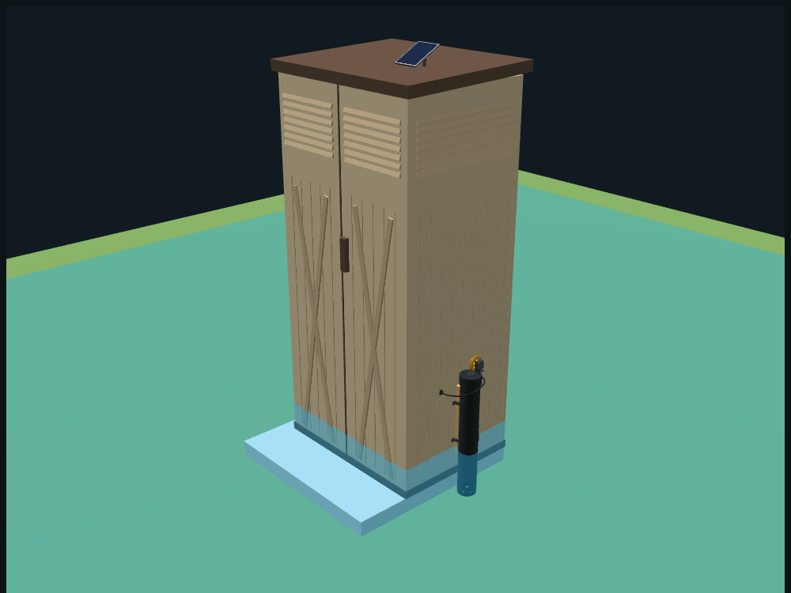
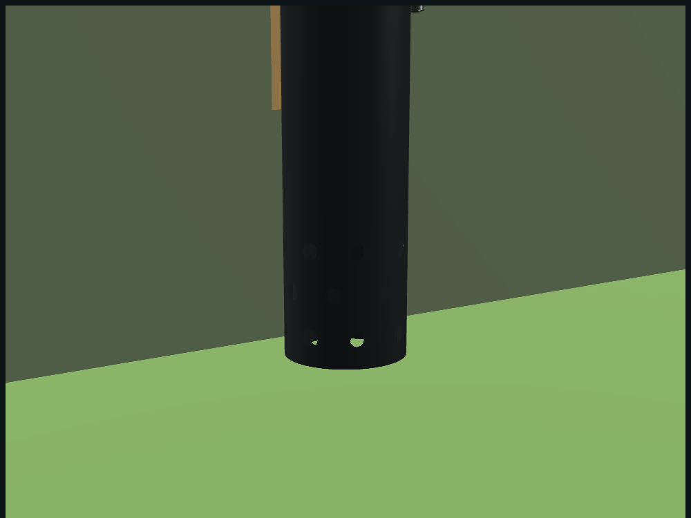
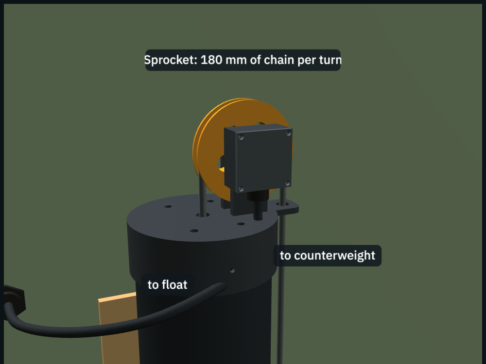

# Flood Gauge

A cheap, deliberately low-tech water level sensor, built from standard plumbing parts plus three small 3D-printed pieces. A plastic bottle floats in a vertical pipe. As the water rises it lifts the bottle, and a ball chain over a pulley turns a magnet. A magnetic angle sensor reads the magnet through a sealed plastic wall, so nothing electrical touches water. An ESP32 just inside the shed counts pulley turns and reports the water level over WiFi.

Built during the November 2026 San Francisco floods.



**Interactive 3D model:** [view it online](https://claude.ai/artifact/73WavGVYFgETyoyXfjjkja), or open [`web/index.html`](web/index.html) through a local web server (`cd web && python3 -m http.server`, then visit http://localhost:8000). The `web/` folder is the source of the online page. It has views for the yard, pulley, sensor (X-ray), float and weights, inlet holes, and the shed interior, plus a water-depth slider and a storm simulation.

## How it works

1. **Stilling well.** A 2 ft length of 3" ABS (or PVC) pipe, black so it blends in, is strapped to a shed or house wall with two standard pipe straps. Three staggered rows of 1/2" holes in the bottom 100 mm let floodwater in. They also smooth out waves and keep debris away from the float.

   

2. **Cap and bracket.** A standard 3" ABS cap pushes onto the top of the pipe. A small printed bracket bolts onto the cap and holds the pulley and the sealed sensor pod.

   

3. **Float.** An empty 500–700 mL plastic bottle, no wider than 70 mm, with sand inside. It hangs from a ball chain through the centre of the cap.
4. **Pulley.** The chain runs over a printed 32-pocket sprocket. The ball pockets mean wet chain can't slip, and one turn moves 192 mm of chain.
5. **Counterweight.** The other end of the chain hangs just outside the pipe. It's an M8 bolt with a stack of washers (16 mm wide, clearing the pipe by about 9 mm), tuned to about 100 g.
6. **Sensor.** A 6×2.5 mm diametric magnet sits in the end of the pulley axle. An AS5600 magnetic encoder in the sealed pod reads the axle angle through a 1.2 mm plastic wall.

   

7. **ESP32.** It counts full turns and adds the angle: 4096 counts per 192 mm turn, about 0.05 mm per count. Expect about 1 mm accuracy in practice.

### How the weights balance


**The float has to be the heavier side.** An empty bottle weighs about 20 g, which isn't enough. Add sand until the bottle weighs about 150 g, and use a 100 g counterweight.

- **Dry pipe:** the float pulls down with 150 g and the counterweight pulls back with 100 g. The float wins by 50 g and rests on the bottom of the pipe.
- **Water arrives:** buoyancy has to supply the missing 50 g. A 66 mm bottle gets that from about 15 mm of submersion (50 cm³ of water). Above that the float lifts off and rides the surface.
- **Water drops:** the float's extra 50 g pulls it back down, and the counterweight rises. The chain stays tight in both directions, so the pulley never skips.

```
float weight in air  >  counterweight  >  float weight − buoyancy
```

## What to make

| Part | File | Make with | Notes |
|---|---|---|---|
| Bracket (pulley uprights and sensor pod) | `out/bracket.stl` / `.step` | 3D printer | Black ASA or PETG. Print lying on the pod's open face, with no supports. |
| Sprocket pulley | `out/pulley.stl` / `.step` | 3D printer | Prints flat with no supports. Glue the magnet into the stub end. |
| Sensor pod lid | `out/sensor_lid.stl` / `.step` | 3D printer | Seal with silicone and fix with 4× M3 screws. |
| Cap drilling template | [`templates/cap_template.pdf`](templates/cap_template.pdf) | Paper | One 3/8" chain hole and three 3/16" bolt holes. |
| Inlet hole template | [`templates/pipe_inlet_template.pdf`](templates/pipe_inlet_template.pdf) | Paper | Two strips that wrap round the pipe. 24 holes, 1/2". |

Print the templates at 100% ("Actual size") and check the 50 mm scale bar with a ruler before drilling.

Sources:
- [`cad/flood_head.py`](cad/flood_head.py) (build123d) for the printed parts.
- [`templates/make_templates.py`](templates/make_templates.py) (no dependencies) for the PDFs.

Edit the parameters and re-run. Measure your chain's pitch and your cap's outside diameter first.

## Assembly

1. Tape the inlet template round the bottom of the pipe and drill 24 holes, 1/2".
2. Tape the cap template on the cap and drill the 3/8" centre hole and three 3/16" bolt holes.
3. Bolt the printed bracket to the cap top with three M4 bolts.
4. Glue the magnet into the pulley stub. Fit the AS5600 in the pod, then run the wire through the PG7 gland and seal the lid.
5. Screw a 3/4" wood batten to the wall so the cap clears it. Strap the pipe to the batten and push the cap on.
6. Fill the bottle with sand to about 150 g. Hang it on the chain down the centre hole, run the chain over the sprocket, and hook the counterweight on the other end. With the float on the bottom, the counterweight should hang at least 5 cm below the cap.
7. Drill a small hole through the wall above flood level, pass the wire through, seal it with silicone, and connect the ESP32 inside.

### Key dimensions

| | |
|---|---|
| Pipe OD | 88.9 mm (3" ABS DWV or 3" Sch40 PVC) |
| Cap OD | about 99 mm (measure yours) |
| Chain | #10 ball chain, 4.5 mm balls, 6.0 mm pitch (measure yours) |
| Pulley | 32 pockets, 61.1 mm pitch diameter, 192 mm of chain per turn |
| Counterweight | M8 bolt and washers, 61 mm from pipe centre, about 9 mm clear of the pipe |
| Sensor wall | 1.2 mm. Magnet-to-chip distance about 2.5–3 mm, inside the AS5600's 0.5–3 mm range |
| Drills | 1/2" (inlets), 3/8" (chain), 3/16" (bracket bolts) |

## Bill of materials

Rough prices, before tax and shipping. Pipe, chain, AS5600 and gland prices come from online listings checked in November 2026. The cap, straps, ESP32-C3, bolts and screws are typical prices, not checked against listings.

| Item | Qty | Est. cost (USD) | Notes |
|---|---|---|---|
| **Plumbing and hardware** | | | |
| 3" ABS DWV pipe, 2 ft | 1 | $13–22 | Ask for an offcut. Drill the inlet holes using the paper template. |
| 3" ABS DWV cap | 1 | $4–8 | Standard push-on cap. Drill it using the paper template. |
| 3" two-hole pipe straps | 2 | $2–4 | Hold the pipe to the wall. |
| Scrap 3/4" wood batten, about 40 cm | 1 | $0 | Spaces the pipe off the wall so the cap clears it. |
| #10 ball chain, about 5 ft, plus 2 connectors | 1 | $4–8 | Nickel-plated steel, bought by the foot. |
| Counterweight: M8×80 bolt, nut, about 20 washers | 1 set | $3–6 | Add or remove washers to tune it to about 100 g. |
| 3× M4×12 bolts with nuts, 4× M3×10 screws, 4 wood screws | 11 | $2–4 | Often already in the parts bin. |
| **Electronics** | | | |
| AS5600 module with diametric magnet | 1 | $2–9 | Many modules include the magnet. |
| ESP32-C3 SuperMini (or any ESP32) | 1 | $3–6 | Small and cheap, with WiFi. |
| PG7 nylon cable gland | 1 | $1–3 | On the sensor pod, facing down. |
| 4-conductor wire, about 2 m | 1 | $0–3 | An old USB cable or Cat5 offcut works. The ESP32 sits just inside the wall. |
| USB phone charger and cable | 1 | $0 | Reuse one you have. |
| Silicone sealant | 1 | $0–5 | Seals the pod lid and the hole through the wall. |
| **Made in-house** | | | |
| 3D-printed bracket, sprocket and lid, about 75 g of ASA or PETG | 3 | $1–2 | Filament cost only. |
| Paper drilling templates | 2 sheets | $0 | From the templates folder. |
| Plastic bottle and sand | 1 | $0 | Recycled. |
| **Total** | | **$35–80** | About $45 if the bolts, screws, charger and wire come from your parts bin. |
| **Optional** | | | |
| Suncast BMS2000 vertical resin storage shed, 2 ft 8 in × 2 ft 1.5 in × 6 ft | 1 | $299 | Not in the total. A dry spot for the ESP32 if you don't have a shed or house wall to use. |
| Solar and battery add-on (see below) | 1 | $16–31 | Not in the total. |

Price sources:

- [3" × 24" ABS pipe, Home Depot](https://www.homedepot.com/p/VPC-3-in-x-24-in-Plastic-ABS-Pipe-1203/202300520)
- [3" × 2 ft ABS pipe, Supply On Time](https://supply-ontime.com/products/plastic-acrylonitrile-butadiene-styrene-abs-pipe-3-in-x-24-in)
- [#10 ball chain spool (about $0.80/ft), Family Hardware](https://www.familyhardware.com/product/lucky-line-10-100-ft-nickel-finished-stainless-steel-ball-chain/455296)
- [#10 ball chain connectors, Zoro](https://www.zoro.com/midwest-fastener-10-x-316-brass-ball-chain-connectors-25pk-64625/i/G002521708/)
- [AS5600 module with magnet, Tinytronics](https://www.tinytronics.nl/shop/en/sensors/magnetic-field/as5600-magnetic-angle-sensor-encoder-module)
- [AS5600 module, Fruugo](https://www.fruugo.ca/as5600-magnetic-encoder-module-magnetic-induction-angle-measurement-sensor-module-foc-12bit-high-precision-sensor/p-447636426)
- [PG7/PG9 cable glands, element14](https://au.element14.com/multicomp-pro/pg9dg/gland-pg9-4-8mm-pk10/dp/1621062)
- [Suncast BMS2000 shed, Home Depot](https://www.homedepot.com/p/Suncast-2-ft-8-25-in-X-2-ft-1-5-in-X-6-ft-Resin-Vertical-Storage-Shed-BMS2000/203702004)

## Wiring


The wire leaves the sensor pod through a downward-facing PG7 gland. It then passes through a small hole in the shed wall, above flood level, sealed with silicone. Leave a drip loop below the hole so water runs off instead of following the wire inside. Because the ESP32 sits just inside the wall, the wire is only about 2 m long.

**Use PWM output.** Set the AS5600's OUT pin to PWM (register `CONF.OUTS = 10`) and use three wires: 3.3 V, GND and OUT. The ESP32 measures the duty cycle (about 920 Hz) on any GPIO. PWM is the most reliable option. I2C usually works over 2 m with 2.2 kΩ pull-ups, but it isn't guaranteed.

At the ESP32:

```
level_mm = (turns * 4096 + raw_angle) / 4096 * 192  - zero_offset
```

- Sample at least every 0.5 s, so the pulley never turns more than half a revolution between samples. Floods rise far slower than that.
- Store `turns` in NVS (flash) every few minutes and at each change. The other option is to re-zero at boot when the ground is dry.
- Report to Home Assistant through ESPHome: a `pulse_width` sensor plus a small lambda for turn counting.

## Optional: solar and battery power

The gauge can run without mains power. Use a single 18650 cell on the shed shelf, charged by a small panel on the shed roof. This only works with low-power firmware, because an ESP32 that keeps WiFi on all the time uses about 25 times more energy.

### Daily energy budget

| Load | How it runs | mAh/day |
|---|---|---|
| AS5600 | Low-power mode 3 (polls every 100 ms), about 1.5 mA | 36 |
| ESP32-C3 | Light sleep, waking every 0.5 s to read the angle, about 1.5 mA average | 36 |
| WiFi reports | Every 15 min when dry: about 3 s at 100 mA each | 8 |
| Board regulator | About 40 µA. Remove the board's power LED, which draws 1–3 mA. | 1 |
| **Dry days, normal use** | | **≈ 80** |
| During a flood | Report every minute instead: +112 mAh | ≈ 190 |
| For comparison | WiFi always on, about 80 mA | ≈ 1900 |

### Sizing the panel and battery

80 mAh at 3.7 V is about **0.3 Wh a day**, rising to 0.7 Wh on flood days.

```
panel W = daily Wh / (sun hours × losses) = 0.7 / (2.5 × 0.5) ≈ 0.6 W
```

San Francisco gets about 2.5 peak sun hours a day in December. Halve that to allow for charger losses, dirt and a less-than-ideal angle on the shed roof. Even then, **a 1 W panel covers normal use**. A **2 W, 6 V panel** gives headroom for grey weeks. On a storm day a panel only makes 10–20% of its rating, so the battery has to carry the storm.

One 3000 mAh 18650 cell lasts about 15 days in flood mode with no sun, or about 5 weeks of dry days. After a storm, a 2 W panel puts back about 700 mAh on a December day, so even a flat cell is full again in about 4–5 days, sooner in summer.

| Solar add-on part | Qty | Est. cost | Notes |
|---|---|---|---|
| 2 W 6 V mini solar panel | 1 | $6–12 | Mounted on the shed roof, tilted south. |
| CN3791 solar Li-ion charger module | 1 | $3–6 | Matches the panel's voltage; a TP4056 ($1) also works. |
| 18650 cell, 3000 mAh, protected | 1 | $5–8 | Use a second cell in parallel for extra margin. |
| 18650 holder and a small box | 1 | $2–5 | Sits on the shelf beside the ESP32. |
| **Solar add-on total** | | **$16–31** | Typical prices, not checked against listings. |

Wiring: panel → charger IN; cell → charger BAT; charger OUT → ESP32 5V pin. The board's own regulator makes 3.3 V for the ESP32 and the AS5600. These current figures are estimates, so measure the real average with a USB power meter before relying on the battery.

## Siting

- Mount the pipe against a house or shed wall at the lowest spot of the yard where water collects. Low black pipe next to a building gets ignored.
- Stand the pipe on a brick so silt can't seal the bottom.
- The counterweight drops as the water rises. Give it as much clear space below the cap as the float's travel.
- Keep the pod's cable gland facing down.

## Status

Concept and CAD. Not yet printed or tested.
