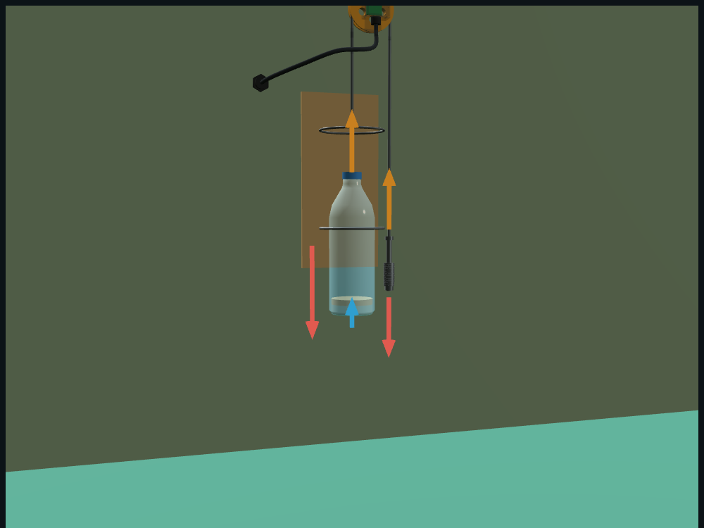
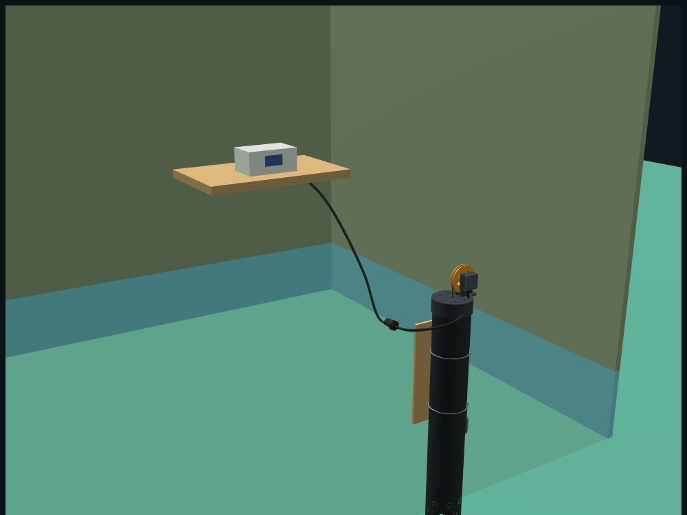

# Flood Gauge

A cheap, deliberately low-tech water level sensor. A plastic bottle floats in a vertical pipe. As the water rises it lifts the bottle, and a ball chain over a pulley turns a magnet. A magnetic angle sensor reads the magnet through a sealed plastic wall, so nothing electrical touches water. An ESP32 kept somewhere dry (in the house or a shed) counts pulley turns and reports the water level over WiFi.

Built during the November 2026 San Francisco floods.


**Interactive 3D model:** [view it online](https://claude.ai/artifact/73WavGVYFgETyoyXfjjkja), or open [`web/index.html`](web/index.html) through a local web server (`cd web && python3 -m http.server`), then visit http://localhost:8000. It has views for the yard, pulley, sensor (X-ray), float and weights, inlet holes, and the shed interior, plus a water-depth slider and a storm simulation.

```
      sensor pod (sealed)                         ESP32 indoors / in shed
          ┌──┐   pulley                           ┌──────────────┐
          │▣ │◯  ← magnet on axle    Cat5 cable   │ ESP32 + PSU  │
          └──┘ ╱ ╲  ───────────────────────────── │ → Home Asst. │
   ═══ cap ═══╪═══╪══                             └──────────────┘
          ║   │   │ counterweight (outside pipe)
  3" ABS  ║   │   ▮
  pipe    ║ ┌─┴─┐
          ║ │   │ bottle float
  ~~~~~~~~║~│~~~│~~~~~~ water
          ║ └───┘
          ╚══ holes near bottom let water in
```

## How it works

1. **Stilling well.** A vertical 3" ABS (or PVC) pipe, black so it blends in, is strapped to a shed or house wall, fence post or stake. Three staggered rows of 12 mm holes in the bottom 100 mm let floodwater in. They also smooth out waves and keep debris away from the float.

   
2. **Float.** An empty 500–700 mL plastic bottle, no wider than 70 mm so it fits in 3" pipe (about 76 mm inside), with a little sand in the bottom so it hangs upright. It hangs from a ball chain down the centre of the pipe.
3. **Pulley.** The chain runs over a 3D-printed sprocket pulley at the top of the pipe. The ball pockets mean the chain can't slip when wet.
4. **Counterweight.** The other end of the chain hangs just outside the pipe and keeps the chain tight, so the float follows the water back down. Use an M8 bolt with a stack of washers (16 mm wide, so it clears the pipe wall by about 5 mm), and add or remove washers to tune it to about 100 g.
5. **Sensor.** A 6×2.5 mm diametric magnet sits in the end of the pulley axle. An AS5600 magnetic encoder in a sealed pod reads the axle angle through a 1.2 mm plastic wall.

   
6. **ESP32.** It counts full turns and adds the angle. One pulley turn equals 180 mm of chain, so the AS5600's 4096 steps per turn give about 0.04 mm per count. Expect about 1 mm accuracy in practice.

### How the weights balance



**The float has to be the heavier side.** An empty bottle weighs about 20 g, which isn't enough. Add sand until the bottle weighs about 150 g, and use a 100 g counterweight.

- **Dry pipe:** the float pulls down with 150 g and the counterweight pulls back with 100 g. The float wins by 50 g and rests on the bottom of the pipe.
- **Water arrives:** buoyancy has to supply the missing 50 g. A 66 mm bottle gets that from about 15 mm of submersion (50 cm³ of water). Above that the float lifts off and rides the surface.
- **Water drops:** the float's extra 50 g pulls it back down, and the counterweight rises. The chain stays tight in both directions, so the pulley never skips.

The rule:

```
float weight in air  >  counterweight  >  float weight − buoyancy (at the depth you want it to float)
```

Example: a 150 g float (bottle plus sand) with a 100 g counterweight. In air, the float has 50 g of net pull and drops to the bottom. In water, a 600 mL bottle gives up to about 600 g of lift, so it floats with only a few centimetres submerged.

## Parts to make

| Part | File | How to make |
|---|---|---|
| Head (pipe cap, pulley uprights, sensor pod) | `out/head.stl` / `.step` | 3D print, black ASA or PETG. Print sleeve-down with tree supports under the top plate. |
| Sprocket pulley | `out/pulley.stl` / `.step` | 3D print flat, 0.2 mm layers. No supports needed. |
| Sensor pod lid | `out/sensor_lid.stl` / `.step` | 3D print with the lip facing up. |
| Mounting plate | `out/mount_plate.dxf` / `.svg` | Laser cut (xTool P2) from 6 mm plywood or acrylic. Two hose clamps hold the pipe, and four screws attach it to the wall or post. |

Source: [`cad/flood_head.py`](cad/flood_head.py) (build123d). Edit the parameters at the top and run `python cad/flood_head.py` to regenerate everything in `out/`. Check `chain_pitch` against your actual chain first.

### Key dimensions

| | |
|---|---|
| Pipe OD | 88.9 mm (3" ABS DWV or 3" Sch40 PVC) |
| Chain | #10 ball chain, 4.5 mm balls, 6.0 mm pitch (measure yours) |
| Pulley | 30 pockets, 57.3 mm pitch diameter, 180 mm of chain per turn |
| Counterweight drop | 57.3 mm from pipe centre, just outside the pipe wall |
| Sensor wall | 1.2 mm. Magnet-to-chip distance about 2.5–3 mm, inside AS5600's 0.5–3 mm range |
| Fasteners | 2× M4 set screws (cap to pipe), 4× M3×10 self-tapping (pod lid), PG7 cable gland |

## Bill of materials

Rough prices from online listings checked in November 2026, before tax and shipping. The ESP32, bolts, clamps, screws, USB power supply and gasket prices are typical figures, not checked against listings.

| Item | Qty | Est. cost (USD) | Notes |
|---|---|---|---|
| **Plumbing and hardware** | | | |
| 3" ABS DWV pipe, 2 ft | 1 | $13–22 | Drill 3 rows of 12 mm holes in the bottom 100 mm. 3" PVC DWV costs about the same. |
| #10 ball chain, 10 ft, with connectors | 1 | $10–45 | Nickel-plated steel at the low end, stainless at the high end. |
| Counterweight: M8×80 bolt, nut, about 20 M8 washers | 1 set | $3–6 | Add or remove washers to tune it to about 100 g. |
| Stainless hose clamps, 3" pipe size | 2 | $4–8 | Strap the pipe to the mounting plate. |
| Screws: 2× M4 set, 4× M3×10 self-tapping, 4 exterior wood | 10 | $3–6 | Often already in the parts bin. |
| Nylon cable glands, PG7 and PG9 | 10-pack each | $6–25 | PG7 on the sensor pod, PG9 through the shed wall. |
| **Electronics** | | | |
| AS5600 module with diametric magnet | 1 | $3–9 | Many modules include the magnet. |
| ESP32 dev board (C3 or S3) | 1 | $5–12 | Any WiFi ESP32 works. |
| Outdoor direct-burial Cat6, 50 ft | 1 | $20–40 | Bulk cable, not a pre-terminated patch lead. |
| USB power supply and cable | 1 | $0–10 | Often on hand. |
| Small box for the ESP32 | 1 | $0–10 | It sits indoors, so it doesn't need to be waterproof. |
| Foam gasket tape and silica gel packets | 1 | $2–6 | Seal the pod lid and keep it dry. |
| **Made in-house** | | | |
| 3D-printed head, pulley and lid, about 130 g of ASA or PETG | 3 | $3–5 | Filament cost only. |
| Laser-cut mounting plate, 6 mm plywood | 1 | $2–4 | xTool P2. |
| Plastic bottle and sand | 1 | $0 | Recycled. |
| **Total** | | **$74–208** | About $100 with nickel chain and the small parts already on hand. |

Price sources:

- [3" × 24" ABS pipe, Home Depot](https://www.homedepot.com/p/VPC-3-in-x-24-in-Plastic-ABS-Pipe-1203/202300520)
- [3" × 2 ft ABS pipe, Supply On Time](https://supply-ontime.com/products/plastic-acrylonitrile-butadiene-styrene-abs-pipe-3-in-x-24-in)
- [3" × 2 ft PVC DWV pipe, Home Depot](https://homedepot.com/p/Charlotte-Pipe-3-in-x-2-ft-PVC-DWV-Sch-40-Pipe-PVC073000200HA/100533056)
- [#10 ball chain connectors, Zoro](https://www.zoro.com/midwest-fastener-10-x-316-brass-ball-chain-connectors-25pk-64625/i/G002521708/)
- [#10 ball chain spool, Family Hardware](https://www.familyhardware.com/product/lucky-line-10-100-ft-nickel-finished-stainless-steel-ball-chain/455296)
- [10 ft stainless #10 ball chain, Bearings Canada](https://bearingscanada.com/products/10-foot-stainless-steel-ball-chain-bead-size-10-ma)
- [AS5600 module with magnet, Tinytronics](https://www.tinytronics.nl/shop/en/sensors/magnetic-field/as5600-magnetic-angle-sensor-encoder-module)
- [AS5600 module, Fruugo](https://www.fruugo.ca/as5600-magnetic-encoder-module-magnetic-induction-angle-measurement-sensor-module-foc-12bit-high-precision-sensor/p-447636426)
- [PG7/PG9 cable glands, element14](https://au.element14.com/multicomp-pro/pg9dg/gland-pg9-4-8mm-pk10/dp/1621062)
- [PG9 cable gland, RS PRO](https://nz.rs-online.com/web/p/cable-glands/8229603)
- [50 ft direct-burial Cat6A, Home Depot](https://homedepot.com/p/Syston-Cable-Technology-50-ft-Black-Direct-Burial-Cat-6A-Ethernet-Internet-Cable-700-MHz-Copper-Outside-Plant-Waterproof-Dual-Layer-Jacket-POE-1796-SB-BK-50/333523192)
- [Direct-burial Cat6 by the foot, ShowMeCables](https://showmecables.com/85-600-340-bk)

## Wiring: long cable to an indoor ESP32



The cable leaves the sensor pod through a downward-facing PG7 gland. It then enters the shed through a second gland (PG9 or a 1/2" conduit gland) placed well above flood level. Leave a drip loop below the wall gland so water runs off instead of following the cable inside.

I2C (the AS5600's default interface) is unreliable past about 1 m. To keep the ESP32 inside the house or a shed, use one of these:

**Option A (simplest): PWM output.** Configure the AS5600's OUT pin for PWM output (register `CONF.OUTS = 10`). The breakout's DIR/PGO pins can stay at their defaults. Run 3.3 V, GND and OUT over one twisted pair of Cat5. The ESP32 measures the duty cycle (about 920 Hz) on any GPIO. This is reliable over 10–30 m. Put a 100 Ω series resistor and a small 1 nF capacitor at the ESP32 end.

**Option B: differential I2C.** Put a PCA9615 board at each end of the Cat5 run. You keep full I2C access, including the magnet-strength status bits, at 30 m or more.

Either way, at the ESP32:

```
level_mm = (turns * 4096 + raw_angle) / 4096 * 180  - zero_offset
```

- Sample at least every 0.5 s, so the pulley never turns more than half a revolution between samples. Floods rise far slower than that.
- Store `turns` in NVS (flash) every few minutes and at each change. The other option is to re-zero at boot when the ground is dry.
- Report to Home Assistant through ESPHome. The `as5600` component handles option B directly. For option A, use a `pulse_width` sensor plus a small lambda for turn counting.

## Siting

- Mount the pipe vertically against a house wall, fence post or a stake driven into the lowest spot of the yard where water collects. Low black pipe next to a house gets ignored.
- Leave the bottom of the pipe a few centimetres above the ground on a brick, or drill plenty of 10 mm holes in the bottom 10 cm. Then silt can't seal it.
- The counterweight drops as the water rises. Give it as much clear space below the cap as the float's travel.
- Put the cap's rain drains and the pod's cable gland facing down.

## Status

Concept and first CAD pass. Not yet printed or tested.
